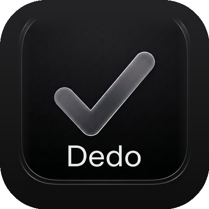
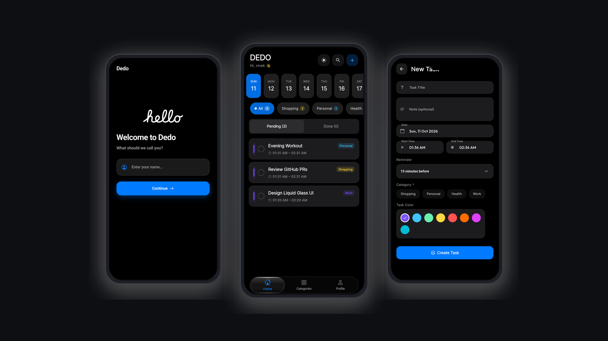
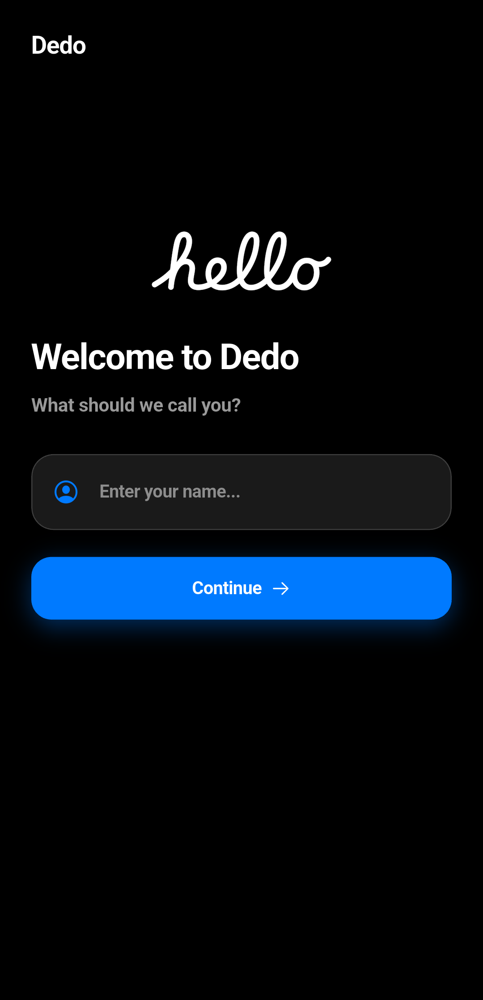
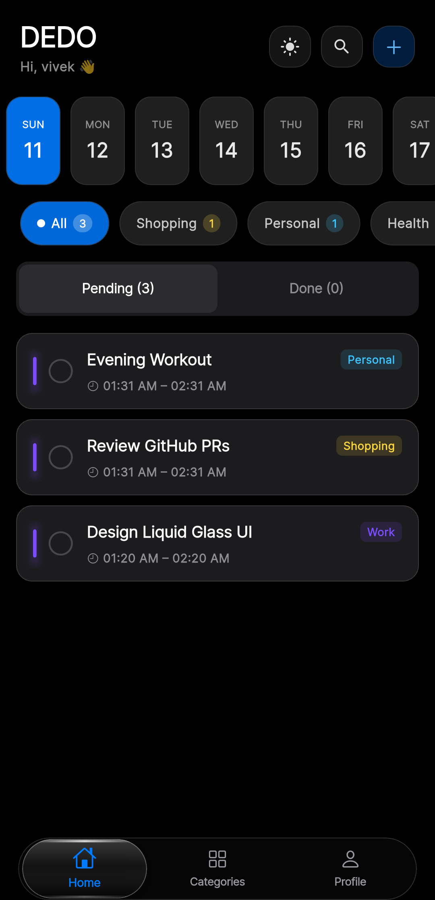
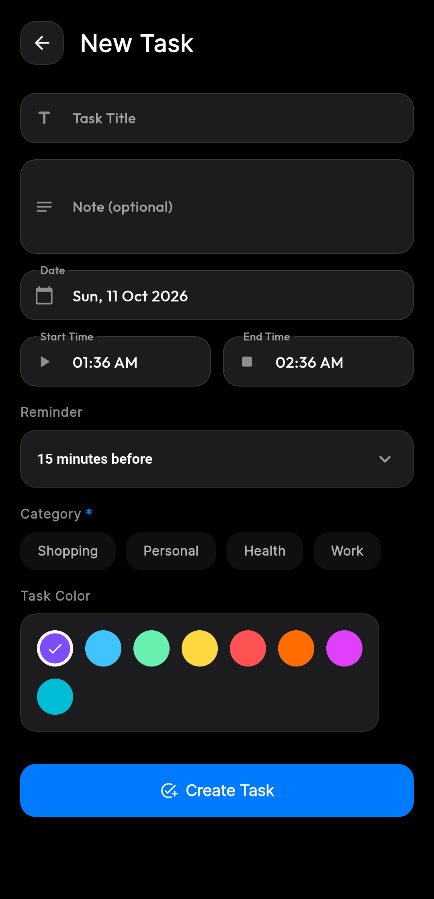
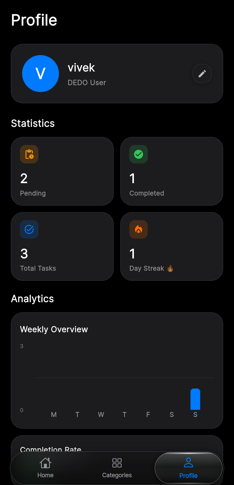

<div align="center">

  

  # Dedo

  **A calm, minimal task manager built with liquid glass aesthetics.**

  [](https://flutter.dev)
  [](https://dart.dev)
  [](https://docs.hivedb.dev)
  [](https://riverpod.dev)
  [](LICENSE)

</div>

<p align="center">
  
</p>

---

## 🌟 Overview

**Dedo** is a simple, focused task manager crafted around simplicity and clarity. Built with Flutter, it embraces a pure **Liquid Glass** aesthetic—combining real-time frosted glassmorphism, dynamic optical reflections, and responsive micro-interactions to create a calm, distraction-free environment for getting things done.

- **Offline-First:** All your data remains private and stored locally on your device with high-performance Hive storage.
- **Distraction-Free:** No clutter, no unnecessary complexity—just intuitive gestures, clear task hierarchy, and peaceful visual design.

---

## 📱 App Showcase

<div align="center">

| Onboarding | Tasks Dashboard | Quick Add Task | Productivity & Stats |
|:---:|:---:|:---:|:---:|
|  |  |  |  |

</div>

---

## ✨ Features

- 🫧 **Liquid Glass UI:** Every modal, navigation bar, input field, and task card is rendered with real-time backdrop blur, frosted translucency, and crystalline specular highlights.
- 🌓 **Adaptive Theming:** Instant, Riverpod-managed light and dark modes that dynamically balance glass blurs, opacity gradients, and contrast levels.
- ⚡ **Gesture-Driven Workflows:** Smooth swipe-to-complete and swipe-to-delete interactions with physical spring resistance and haptic feedback ticks.
- 🏷️ **Organized Categories:** Color-coded grouping with customizable category tags and quick filter chips.
- 📊 **Productivity Insights:** Visual completion rings, day streak tracking, and weekly progress charts powered by `fl_chart`.
- 🔔 **Smart Reminders:** Scheduled local push notifications (pre-reminders, start time, and due alerts) with zero battery drain.
- 🔒 **Privacy & Speed:** Instant startup and seamless offline persistence with edge local data storage built on **Hive**.

---

## 🛠 Tech Stack

| Component | Technology |
|---|---|
| **Framework** | Flutter (Dart) |
| **State Management** | Riverpod (`flutter_riverpod`) |
| **Local Database** | Hive |
| **Notifications** | `flutter_local_notifications` |
| **Data Visualization** | `fl_chart` |
| **Typography** | Google Fonts (Outfit) |

---

## 🏗 Architecture

Dedo is structured with a modular, feature-first approach:

```text
lib/
├── core/             # Liquid Glass design tokens, theme engine, and glass components
│   ├── theme/        # Light & dark glass palettes, opacity curves, color constants
│   └── widgets/      # GlassContainer, GlassTextField, GlassButton, LiquidNavBar
├── features/         # Domain-driven feature modules
│   ├── home/         # Task dashboard, segmented filters, and swipeable task cards
│   ├── task/         # Task creation sheet, priority tags, and time pickers
│   ├── category/     # Custom category manager and palette selectors
│   ├── profile/      # User settings, theme toggle, and statistics overview
│   └── onboarding/   # Ambient greeting screen and profile setup
├── models/           # Hive TypeAdapter models (Task, Category, UserProfile)
├── providers/        # Riverpod state notifiers and reactive providers
└── services/         # Hive database initialization & notification scheduling
```

---

## 🚀 Getting Started

### Prerequisites

- Flutter SDK (v3.19 or later)
- Android SDK / Xcode for iOS
- Android device or emulator running Android 8.0+

### Installation

1. **Clone the repository:**
   ```bash
   git clone https://github.com/Vivek-k001/DEDO.git
   cd DEDO
   ```

2. **Install dependencies:**
   ```bash
   flutter pub get
   ```

3. **Run the application:**
   ```bash
   flutter run
   ```

### Building the Release APK

To build an optimized, standalone release APK for Android:

```bash
flutter build apk --release
```

The compiled APK will be located at:
`build/app/outputs/flutter-apk/app-release.apk`

---

## 🤝 Developed By

**VNJ Softworks**  
Contact: [sdedodedo80@gmail.com](mailto:sdedodedo80@gmail.com)

---

## 📄 License

This project is licensed under the MIT License - see the [LICENSE](LICENSE) file for details.

